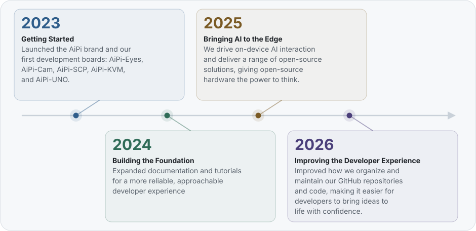

# Ai-Thinker AiPi

**Open Source Project Team · Ai-Thinker Technology**
*安信可科技 · 开源项目团队*

   

 

---

## About Us

AiPi is the open-source hardware brand of **Ai-Thinker Technology**.

Guided by our brand promise "Make Ideas Land with Confidence," we aim to lower the technical barrier so that every enthusiast can turn ideas into real products and enjoy the DIY smart-development journey from concept to creation.

## Milestones Timeline

<picture>
  <source media="(prefers-color-scheme: dark)" srcset="assets/timeline-en-dark.svg">
  
</picture>

## GitHub Main Repository

  

