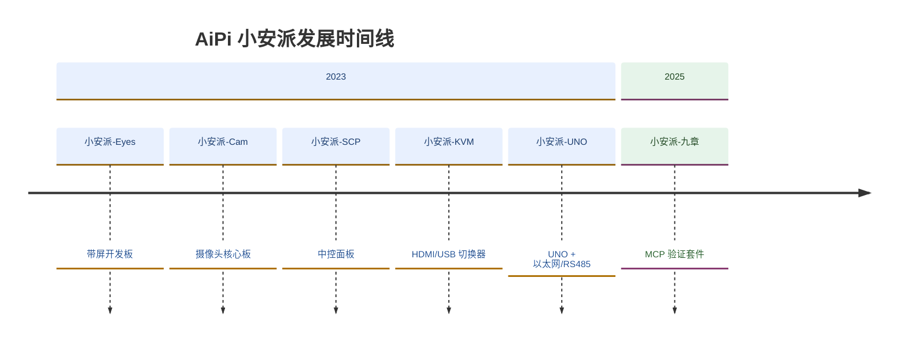

# Ai-Thinker AiPi · 小安派

**安信可科技 · 开源开发板团队**
*Open-source development board team at Ai-Thinker*

[官网 Website](https://www.ai-thinker.com) · [文档 Docs](https://docs.ai-thinker.com) · [商城 Store](https://shop.ai-thinker.com) · [社区 Community](https://www.ai-thinker.com/community)

---

## 关于我们 About

小安派（AiPi）是安信可科技旗下的开发板团队，围绕 Wi-Fi / 蓝牙模组做「拿起来就能玩」的开源硬件：开发板、屏幕、摄像头、外壳，以及配套的 SDK、示例固件与调试工具，全部开源。

AiPi is Ai-Thinker's development board team, building open-source hardware around Wi-Fi / Bluetooth modules — boards, displays, cameras and enclosures, plus the SDKs, sample firmware and debug tools that go with them.

## 发展时间线 Timeline

> 时间线持续补充中，欢迎补充遗漏的里程碑。

## 产品线 Product Lines

| 系列 | 定位 | 代表型号 |
| --- | --- | --- |
| Eyes 系列 | 带屏交互开发板 | AiPi-Eyes-S1/S2、R1/R2 |
| Cam 系列 | 摄像头方案 | Cam-D200、Cam-U |
| SCP 系列 | 中控面板 | SCP-4.3 |
| UNO 系列 | UNO 兼容，以太网 / RS485 | AiPi-UNO |
| 语音交互 | AI 语音对话开发板 | PalChat V1/V2/V3 |
| 其他 | 屏幕驱动 / 墨水屏 / LoRaWAN / KVM | DSL、ESL-2.13、LRW-TH1、KVM |

## 开发者入口 Get Started

- **SDK**：`aithinker_dev_sdk` — 基于 bouffalo_sdk 的中间件与板级封装
- **文档**：[docs.ai-thinker.com](https://docs.ai-thinker.com)
- **示例**：各开发板仓库的 `examples/` 目录
- **烧录调试**：FlashKey — 一键烧录与串口日志采集

## 参与 & 反馈 Contributing

- 文档或示例有问题 → 到对应仓库提 Issue
- 想贡献板级支持 → 提 PR，或先在 Discussions 说明方案
- 商务 / 技术支持：support@aithinker.com

**安信可科技 · Ai-Thinker Technology**

Made with ❤️ for makers, students and engineers.

