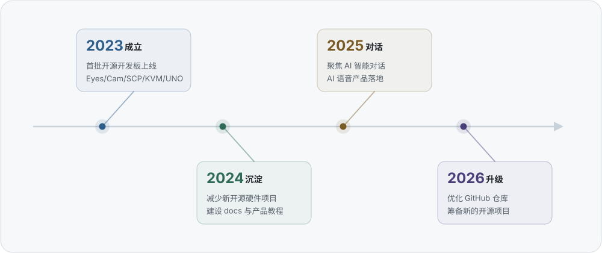

# Ai-Thinker AiPi · 小安派

**安信可科技 · 开源开发板团队**
*Open-source development board team at Ai-Thinker*

   

**中文** · [English](README.en.md)

---

## 关于我们 About

小安派（AiPi）是**深圳市安信可科技有限公司**旗下的开源硬件团队。安信可长期专注物联网无线通信，模组产品覆盖 Wi-Fi、蓝牙、LoRaWAN、NB-IoT、GPS、雷达、UWB 等方向；小安派把这些模组做成开箱即用的开发板与整机方案，把射频、天线这些底层细节留在模组里，开发者专注把想法做成产品。

## 发展时间线 Timeline

<picture>
  <source media="(prefers-color-scheme: dark)" srcset="assets/timeline-dark.svg">
  
</picture>

## GitHub 主仓库

  

